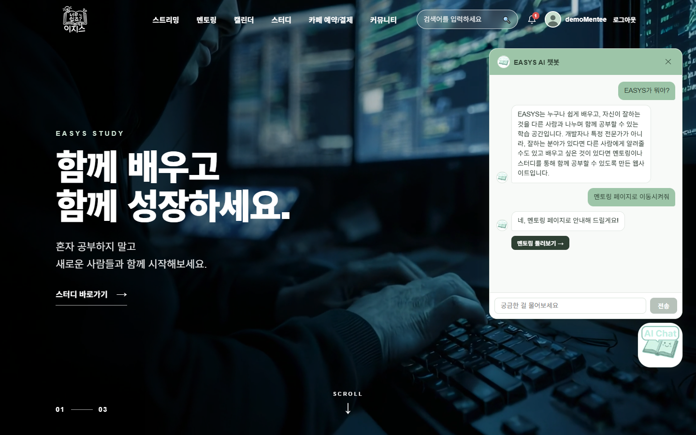
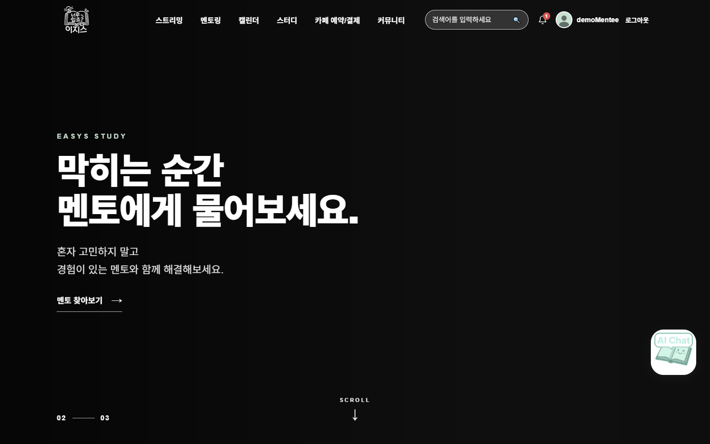
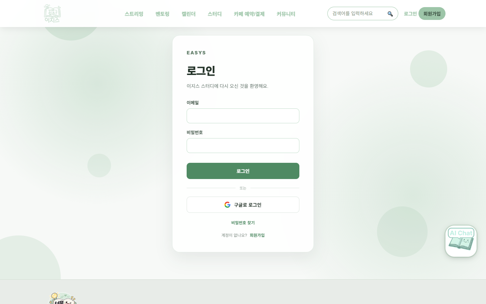
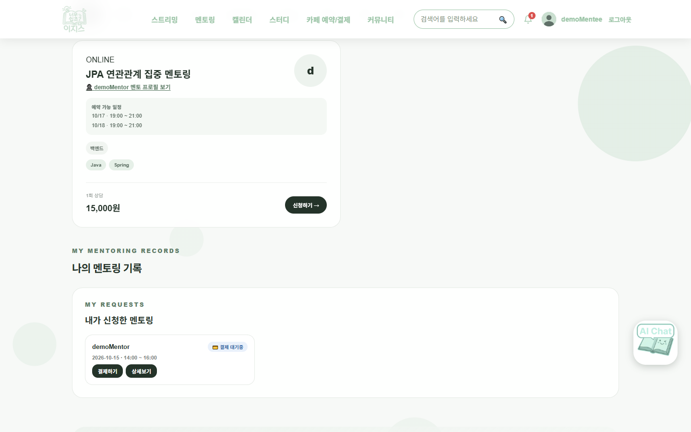
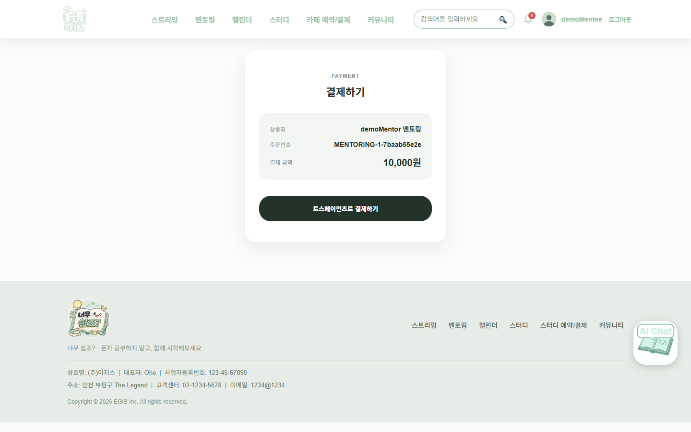
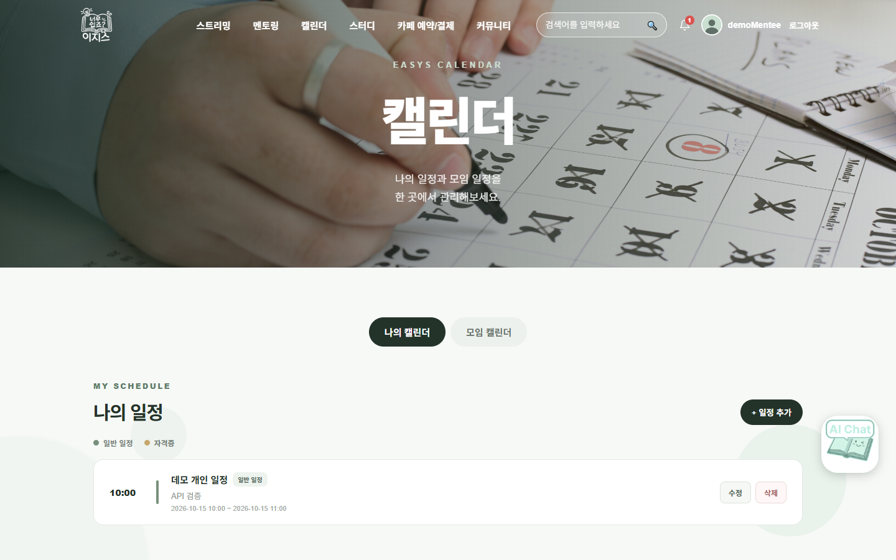
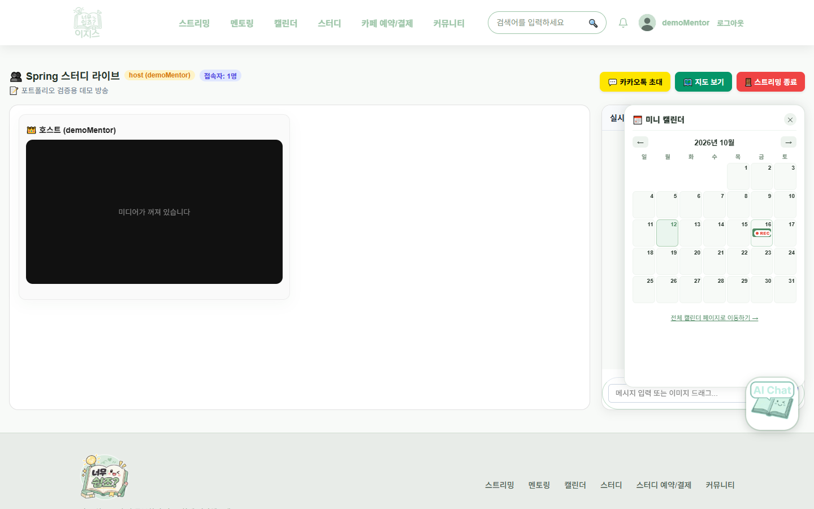
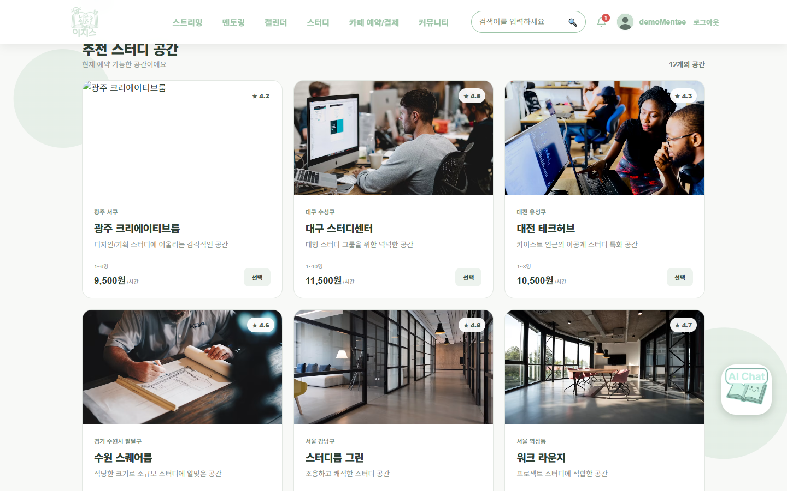

# EASYS


[](https://easys.3-34-197-34.sslip.io)
[](https://scrawny-catfish-f6c.notion.site/EASYS-3ff70177d2b4805cb796cdcad9beeef8)
[](https://github.com/NullTTa)

**[서비스 바로가기](https://easys.3-34-197-34.sslip.io)** · [테스트 계정](#서비스-바로-써-보기) · [노션 정리](https://scrawny-catfish-f6c.notion.site/EASYS-3ff70177d2b4805cb796cdcad9beeef8) · [포트폴리오](https://scrawny-catfish-f6c.notion.site/14f6a35562534556beb1982f741cf0be)

**공부에 필요한 것들을 한곳에 모은 학습 플랫폼입니다.**
멘토에게 1:1로 질문하고, 스터디카페를 예약하고, 화상으로 함께 공부하고, 그 일정을 캘린더에서 관리할 수 있습니다.
사이트 사용법이 헷갈리면 AI 챗봇에게 물어보면 됩니다. 챗봇이 기능을 설명하고 해당 페이지로 바로 이동시켜 줍니다.



| | |
|---|---|
| 형태 | 팀 프로젝트 (3명) |
| 기간 | 2026.08.21 ~ 2026.09.14 |
| 내 역할 | 전체 디자인·UI, AI 챗봇, 캘린더 연동, 멘토링 |
| 원본 저장소 | [lj8888151214-commits/easys](https://github.com/lj8888151214-commits/easys) (팀 전체 커밋 기록) |

이 저장소는 팀 프로젝트 코드를 제 포트폴리오용으로 옮겨 정리한 것입니다. 정리하면서 바꾼 내용은 [맨 아래](#이-저장소에-대해)에 적었습니다.

---

## 서비스 바로 써 보기

AWS에 직접 배포해 두었습니다. 👉 **https://easys.3-34-197-34.sslip.io**

> 🔑 **테스트 계정 (관리자 권한)**
> - 아이디: `sk05ek@naver.com`
> - 비밀번호: `1234qwer!`
>
> 채용 담당자분들이 관리자 화면까지 바로 보실 수 있도록 열어 둔 공용 계정입니다. 둘러보실 때 기존 데이터 삭제는 삼가 주세요.

- 결제는 Toss Payments **테스트 모드**라 실제 돈이 나가지 않습니다.
- 학습용 서버라 데이터가 초기화되거나 잠시 멈출 수 있습니다.

---

## 어떤 서비스인가요?

| 기능 | 할 수 있는 일 |
|---|---|
| 멘토링 | 멘토가 상담 가능한 날짜를 올리면, 배우고 싶은 사람이 신청합니다. 멘토가 승인하면 결제하고, 결제가 끝나면 두 사람의 캘린더에 일정이 들어갑니다. 상담 중에는 1:1 채팅을 합니다. |
| 스터디카페 예약 | 스터디룸을 골라 시간을 예약하고 결제합니다. 관리자가 승인하면 캘린더에 일정이 들어갑니다. |
| 화상 스트리밍 | 방을 만들어 화상으로 함께 공부합니다. 방장은 방 안의 미니 캘린더에 다음 방송 일정을 올릴 수 있습니다. |
| 캘린더 | 직접 넣은 일정, 멘토링·스터디카페·방송 일정을 한곳에서 봅니다. |
| AI 챗봇 | "멘토링이 뭐야?", "멘토링 페이지로 가줘", "내 일정 알려줘" 같은 질문에 답합니다. |
| 스터디·커뮤니티 | 스터디원을 모집하고, 게시판에서 글과 댓글을 나눕니다. |

---

## 제가 맡은 부분

| 영역 | 한 일 |
|---|---|
| **디자인·UI** | 서비스 전체 디자인과 공통 화면(헤더, 푸터)을 맡았습니다. 메인, 캘린더, 멘토링, 결제, 챗봇 화면은 직접 구현했습니다. |
| **AI 챗봇** | 처음에는 Gemini로 연결했다가 내 PC에서 돌아가는 로컬 AI(Ollama의 `qwen2.5:3b`)로 바꿨습니다. 질문을 먼저 분류해서 답하는 방식과 대화 기억, 페이지 이동 버튼을 만들었습니다. |
| **캘린더 연동** | 개인 캘린더를 만들고, 멘토링 결제·스터디카페 예약 확정·방송 일정이 캘린더로 들어오도록 연결했습니다. |
| **멘토링** | 멘토 등록부터 신청, 승인·거절, 결제, 완료, 후기, 1:1 채팅과 멘토링 알림까지 만들었습니다. |

### 팀원과 나눠서 한 부분
- **스터디카페 예약:** 예약·스터디룸 기능과 관리자 승인은 팀원이 만들었습니다. 저는 예약이 확정될 때 캘린더에 일정을 넣고, 취소될 때 지우는 부분을 맡았습니다.
- **미니 캘린더:** 처음 화면 틀과 화상 스트리밍 페이지는 팀원이 만들었습니다. 저는 일정을 저장·조회하는 기능과 방송방 화면 연결을 맡았습니다.
- **알림:** 알림을 저장하고 헤더 종 아이콘에 보여 주는 기능은 팀원이 만들었습니다. 저는 멘토링 승인, 결제 완료, 채팅 메시지가 생길 때 알림을 보내는 부분을 맡았습니다.

화상 스트리밍(WebRTC), 스터디, 커뮤니티, 스터디카페 예약·관리자 기능은 주로 팀원들이 만들었습니다.

---

## 제가 해결한 문제

### 1. 챗봇이 질문을 잘못 이해하거나, 없는 페이지를 안내하는 문제
- **문제:** 작은 AI 모델은 그럴듯한 말을 지어냅니다. 실제로 "스터디룸에서 스트리밍 시작" 같은 없는 기능을 안내하거나, 한국어 답변에 한자를 섞는 일이 있었습니다. 주소까지 AI에게 맡기면 없는 페이지로 보낼 위험도 있었습니다.
- **수정:** 질문이 오면 AI에게 보내기 전에 코드로 먼저 분류하게 했습니다(`FeatureIntentClassifier`). "멘토링 페이지로 가줘" 같은 이동 요청은 AI를 거치지 않고, 서버가 정해 둔 페이지 버튼만 보냅니다. 내 일정, 인기 방송처럼 정답이 DB에 있는 질문도 AI 없이 DB에서 바로 답합니다.
- **확인:** 분류 테스트 40개가 모두 통과합니다. 실제로 서버를 띄워 "멘토링 페이지로 이동시켜줘"를 입력하면 버튼이 나오고, 누르면 `/mentor`로 이동하는 것을 확인했습니다.
- 포트폴리오를 정리하면서 띄어쓰기가 들어간 질문을 분류하지 못하는 버그를 하나 더 찾아 고쳤습니다. 자세한 내용은 [트러블슈팅 B4](docs/TROUBLESHOOTING.md#b4-챗봇-의도-분류-테스트-3건-실패)에 있습니다.

### 2. 외부 AI 대신 로컬 AI를 쓴 이유
- **문제:** Gemini 같은 외부 AI는 API 키를 관리해야 하고, 사용량에 따라 비용과 호출 제한이 생깁니다.
- **수정:** Ollama로 `qwen2.5:3b` 모델을 내 PC에서 돌리도록 바꿨습니다. 모델 이름과 주소는 설정값으로 빼서, 나중에 다른 모델로 쉽게 바꿀 수 있게 했습니다.
- **확인:** 로컬 모델로 챗봇이 답하는 것을 확인했습니다. 대신 외부 AI보다 느리고 정확도가 낮았습니다. 이 PC에서는 첫 답변이 모델 로딩 때문에 2분 가까이 걸렸고, 그 뒤로는 수 초에서 30초 정도 걸렸습니다. 1번에서 AI가 할 일을 줄인 것도 이 단점을 보완하려는 목적이었습니다.

### 3. 결제 금액과 주문자를 서버에서 확인하는 이유
- **문제:** 결제 금액을 브라우저가 보낸 값 그대로 믿으면 사용자가 금액을 바꿔서 보낼 수 있습니다. 결제 승인에 필요한 비밀 키가 브라우저에 있으면 안 되는 문제도 있습니다.
- **수정:** 결제 승인은 서버만 TossPayments에 요청합니다. 요청하기 전에 이 주문이 로그인한 사람의 것인지, 금액이 DB에 저장된 금액과 같은지 먼저 확인합니다(`PaymentService`).
- **확인:** 금액을 1원으로 바꾼 요청과 다른 사람 계정으로 같은 주문을 승인하려는 요청이 TossPayments에 가기 전에 거절되는 것을 확인했습니다. 실제 결제 승인은 테스트 키가 없어 확인하지 못했습니다.

### 4. 결제와 예약 일정을 연결한 방식
- **문제:** 신청이나 승인만으로 캘린더에 일정을 넣으면, 결제하지 않아 실제로 열리지 않을 상담도 캘린더에 남게 됩니다.
- **수정:** 멘토링 일정은 **결제가 끝난 뒤에만** 멘토와 신청자 캘린더에 넣습니다. 멘토가 거절하면 결제를 취소하고 일정도 지웁니다. 스터디카페는 결제 후 관리자가 승인할 때 일정을 넣고, 관리자가 취소하면 지웁니다.
- **확인:** 멘토링 신청 → 멘토 승인 → 결제 대기까지 확인했고, 그 시점에는 캘린더에 일정이 들어가지 않았습니다. 결제가 끝난 뒤 일정이 들어가는 단계는 실제 결제가 필요해서 아직 확인하지 못했습니다.

### 5. 미니 캘린더 연결이 끊기고 날짜가 고정돼 있던 문제
- **문제:** 팀 코드를 합치는 과정에서 방송방 화면이 미니 캘린더에 옛날 데이터를 넘기고 있었습니다. 같은 코드가 두 번 들어가 화면도 깨져 있었습니다. 또 미니 캘린더가 오늘 날짜와 상관없이 항상 2026년 8월로 열렸습니다.
- **수정:** 끊긴 연결을 다시 잇고 중복 코드를 지웠습니다. 날짜를 고정해 둔 코드(`new Date(2026, 7, 27)`)는 오늘 날짜로 바꿨습니다.
- **확인:** 방장 화면에서 미니 캘린더가 이번 달로 열리고, 등록한 방송 일정이 해당 날짜에 표시되는 것을 확인했습니다. 시청자 화면과 여러 명이 동시에 볼 때의 동작은 아직 확인하지 못했습니다.

---

## 사용한 기술

| 기술 | 프로젝트에서 한 일 |
|---|---|
| **Java 25 / Spring Boot 4.1** | 서버를 만들었습니다. 화면이 요청하면 데이터를 처리해서 돌려줍니다. |
| **Spring Security** | 로그인을 처리합니다. 로그인 상태는 세션(서버가 로그인한 사용자를 기억하는 방식)으로 유지하고, Google 로그인도 지원합니다. |
| **Spring Data JPA** | 자바 코드로 DB를 다룹니다. SQL을 직접 쓰지 않아도 데이터를 저장하고 꺼낼 수 있습니다. |
| **MySQL 8** | 회원, 예약, 결제, 일정 같은 데이터를 저장하는 DB입니다. |
| **Redis** | 빠르게 읽고 쓰는 임시 저장소입니다. 챗봇이 최근 대화를 기억하는 데 썼습니다. |
| **React 19 / Vite** | 사용자가 보는 화면을 만들었습니다. Vite는 개발 서버와 빌드 도구입니다. |
| **Ollama / Qwen2.5 3B** | Ollama는 AI 모델을 내 PC에서 실행해 주는 프로그램이고, Qwen2.5 3B는 그 위에서 돌린 작은 언어 모델입니다. 챗봇의 답변을 만듭니다. |
| **WebSocket / STOMP** | 새로고침 없이 실시간으로 메시지를 주고받는 방식입니다. 멘토링 채팅에 썼습니다. 화상 스트리밍의 연결 신호도 WebSocket으로 주고받습니다. |
| **TossPayments** | 결제 서비스입니다. 테스트 모드로 연결했습니다. |
| **Kakao Maps / SDK** | 지도와 카카오톡 초대 기능에 씁니다. |

원본 팀 README에는 PostgreSQL, JWT, Docker, AWS가 적혀 있지만, 실제 코드에는 해당 설정이 없어서 넣지 않았습니다.

전체 구조는 [ARCHITECTURE.md](docs/ARCHITECTURE.md)에 그림으로 정리했습니다.

---

## 화면

모두 개발용 DB와 테스트 계정으로 실제로 실행해서 찍었습니다.

| 메인 | 로그인 |
|---|---|
|  |  |

| 멘토링 목록과 내 신청(결제 대기) | 결제 화면 (결제 전) |
|---|---|
|  |  |

| 개인 캘린더 | 방송방 미니 캘린더 (방장 화면) |
|---|---|
|  |  |

| 스터디카페 예약 | AI 챗봇 |
|---|---|
|  |  |

사용자가 기능을 쓰는 순서는 [FEATURE_FLOWS.md](docs/FEATURE_FLOWS.md)에 정리했습니다.

---

## 직접 실행해 보기

**준비물:** JDK 25, Node.js 24, MySQL 8, Redis. 챗봇까지 쓰려면 Ollama를 설치하고 `ollama pull qwen2.5:3b`로 모델을 받습니다.

**1. 개발용 DB 만들기**
서버가 켜질 때 테이블을 자동으로 바꾸고 기본 데이터도 넣습니다. 그래서 다른 프로젝트와 같은 DB를 쓰지 말고 새로 만드는 것이 안전합니다.
```sql
CREATE DATABASE easys_portfolio_dev CHARACTER SET utf8mb4 COLLATE utf8mb4_unicode_ci;
CREATE USER 'easys_dev'@'localhost' IDENTIFIED BY '<로컬 비밀번호>';
GRANT ALL PRIVILEGES ON easys_portfolio_dev.* TO 'easys_dev'@'localhost';
```

**2. 설정 파일 만들기**
- `src/main/resources/application-local.properties.example`을 복사해서 `application-local.properties`로 저장하고 값을 채웁니다. 이 파일은 Git에 올라가지 않습니다.
- `frontend/.env.example`을 복사해서 `frontend/.env.local`로 저장합니다.

| 설정 | 꼭 필요? | 용도 |
|---|---|---|
| `DB_URL`, `DB_USERNAME`, `DB_PASSWORD` | 필요 (`DB_PASSWORD`는 기본값 없음) | MySQL 연결 |
| `REDIS_HOST`, `REDIS_PORT` | 기본값 있음 | Redis 연결 |
| `LLM_BASE_URL`, `LLM_MODEL` | 기본값 있음 | Ollama 주소와 모델 |
| `GMAIL_USERNAME`, `GMAIL_APP_PASSWORD` | 선택 | 인증 메일, 스터디카페 예약 알림 메일 |
| `TOSS_CLIENT_KEY`, `TOSS_SECRET_KEY` | 선택 | 결제 (테스트 키만) |
| `GOOGLE_CLIENT_ID`, `GOOGLE_CLIENT_SECRET` | 선택 | Google 로그인 |
| `ADMIN_BOOTSTRAP_EMAIL` | 선택 | 처음 관리자로 지정할 계정 |
| `VITE_TOSS_CLIENT_KEY`, `VITE_KAKAO_JS_KEY`, `VITE_API_URL` | 선택 | 화면 쪽 결제·지도·서버 주소 |

**3. 실행**
```bash
./gradlew bootRun                      # 서버 (http://localhost:8080)
cd frontend && npm ci && npm run dev   # 화면 (http://localhost:5173)
```
이 순서는 2026-10-12에 Windows 10에서 메일·결제·Google·Kakao 키를 비운 채로 실행해 확인했습니다.

---

## 테스트와 확인 범위

**자동 테스트**
- 서버 테스트(`./gradlew test`): 41개 모두 통과 (챗봇 질문 분류 40개 + 서버 전체 실행 1개)
- 화면 빌드(`npm run build`): 성공
- 코드 스타일 검사(ESLint): 오류 94개, 경고 17개가 남아 있습니다. 원본 코드에 있던 문제입니다.
- Windows에서 폴더 경로에 한글이나 공백이 있으면 서버 테스트가 실행되지 않습니다. 영어 경로에서 실행했습니다.

**직접 실행해서 확인한 것**
- 회원가입, 로그인
- 챗봇: 서비스 소개, 페이지 이동 버튼, 오타("멪토링") 확인, 내 일정 조회, 비로그인 사용자 3회 제한
- 개인 캘린더 일정 등록과 조회
- 멘토 등록 → 멘토링 등록 → 신청 → 승인 → 결제 대기
- 금액을 바꾼 결제 요청과 다른 사람의 결제 요청 거절
- 결제 화면, 스터디룸 목록, 방장 화면의 미니 캘린더

**아직 확인하지 못한 것**
- 실제 결제 승인과 그 뒤 캘린더에 일정이 들어가는 단계 (멘토링, 스터디카페)
- 스터디카페 예약 → 결제 → 관리자 승인 전체 과정
- 멘토링 완료와 후기, 실시간 채팅 주고받기, 알림 화면 표시
- 이메일 발송, Google 로그인, Kakao 지도
- 여러 명이 함께 쓰는 화상 스트리밍, 시청자의 "내 캘린더에 추가"

---

## 아쉬운 점과 다음에 고칠 것
- 서버에서 오류가 나면 내부 오류 내용(스택 트레이스)이 그대로 응답에 보입니다.
- 회원가입 입력값(생년월일 6자리, 닉네임 10자)을 서버에서 검사하지 않아, 잘못 입력하면 500 오류가 납니다.
- 방송방 화면에서 스터디 그룹 일정을 부를 때 필요한 값(`start`)을 빼먹어 400 오류가 납니다. 지금 미니 캘린더는 이 데이터를 쓰지 않습니다.
- 화면 코드 여러 곳에 서버 주소(`:8080`)가 직접 적혀 있어 설정으로 모아야 합니다.
- 결제 승인부터 캘린더 등록까지 자동으로 확인하는 테스트가 없습니다.
- 배포는 AWS에 직접 했지만, 배포 스크립트와 서버 설정은 이 저장소에 아직 정리하지 못했습니다.

---

## 이 저장소에 대해

팀 원본 `develop` 브랜치(`33278e6`)를 바탕으로 아래 내용을 바꿨습니다.

1. 팀 저장소에 올리지 못한 제 커밋(`043b9b7`, 미니 캘린더 연결 복구)과 정리 중이던 수정 사항을 넣었습니다.
2. 원본에서 화면 빌드가 실패하던 문제를 고쳤습니다. 저장소에 없는 영상 파일을 불러오고 있었습니다.
3. 설정 파일에 그대로 적혀 있던 비밀번호와 키를 환경 변수로 옮기고, 예시 파일만 남겼습니다.
4. 챗봇 분류 버그, 미니 캘린더 날짜 고정 버그를 고치고 실패하던 테스트를 정리했습니다.
5. 팀 내부 문서와 빌드 결과물은 빼고, 문서와 실행 화면을 추가했습니다.

자세한 과정은 [TROUBLESHOOTING.md](docs/TROUBLESHOOTING.md)에 있습니다.

**상세 문서:** [프로젝트 개요](docs/PROJECT_OVERVIEW.md) · [전체 구조](docs/ARCHITECTURE.md) · [기능 흐름](docs/FEATURE_FLOWS.md) · [트러블슈팅](docs/TROUBLESHOOTING.md)
