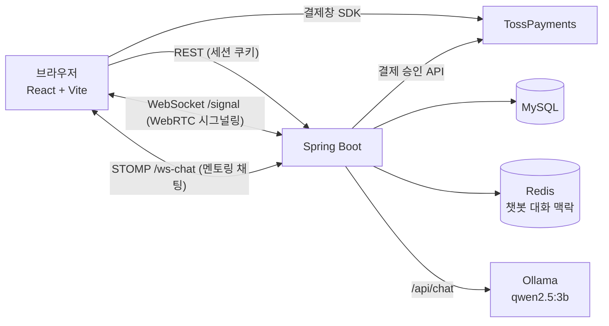

# EASYS — 스터디·멘토링·스트리밍 통합 학습 플랫폼


> 스터디 모집, 스터디카페 예약, 1:1 멘토링, 화상 스트리밍, 일정 관리, AI 챗봇을 한 곳에서 제공하는 웹 서비스입니다.

- **팀 프로젝트 (3명)** · 개발 기간 2026-08-21 ~ 2026-09-14 (원본 저장소 커밋 기준)
- 원본 팀 저장소: **https://github.com/lj8888151214-commits/easys** (전체 커밋 이력)
- 이 저장소는 원본 `develop`(`33278e6`)을 개인 포트폴리오용으로 정리한 **코드 스냅샷**입니다. 정리하면서 바꾼 내용은 [스냅샷 변경 내역](#12-스냅샷-변경-내역)에 적었습니다.

## 목차
1. [프로젝트 소개](#1-프로젝트-소개)
2. [팀 구성과 내 담당 업무](#2-팀-구성과-내-담당-업무)
3. [주요 기능](#3-주요-기능)
4. [기술 스택](#4-기술-스택)
5. [시스템 아키텍처](#5-시스템-아키텍처)
6. [핵심 흐름](#6-핵심-흐름)
7. [주요 화면](#7-주요-화면)
8. [문제 해결과 기술적 의사결정](#8-문제-해결과-기술적-의사결정)
9. [로컬 실행](#9-로컬-실행)
10. [테스트와 검증 결과](#10-테스트와-검증-결과)
11. [알려진 제한과 향후 개선](#11-알려진-제한과-향후-개선)
12. [스냅샷 변경 내역](#12-스냅샷-변경-내역)

상세 문서: [프로젝트 개요](docs/PROJECT_OVERVIEW.md) · [아키텍처](docs/ARCHITECTURE.md) · [기능 흐름](docs/FEATURE_FLOWS.md) · [트러블슈팅](docs/TROUBLESHOOTING.md)

---

## 1. 프로젝트 소개

혼자 공부하는 사람이 **배울 곳(멘토링·스터디)**, **공부할 공간(스터디카페)**, **함께하는 시간(화상 스트리밍)**, **일정 관리(캘린더)**를 서비스 하나에서 해결하도록 만든 학습 플랫폼입니다.

- 멘토링·스터디카페 예약을 결제까지 마치면 일정이 **개인 캘린더에 자동 등록**됩니다.
- 로컬 LLM 기반 **AI 챗봇**이 서비스 기능을 안내하고, 필요한 페이지로 바로 이동시켜 줍니다.

---

## 2. 팀 구성과 내 담당 업무

팀원은 **3명**(본인 포함)입니다.

### 내 담당 업무

| 영역 | 담당 내용 | 코드 근거 (원본 저장소 기준) |
|---|---|---|
| **전체 디자인·UI** | 서비스 전반의 디자인과 UI 구현, 주요 페이지와 공통 UI 구성, 화면 간 사용자 흐름과 일관성 개선 | 메인(`Home`), 헤더·푸터, 캘린더, 멘토링, 결제, AI 챗봇 화면을 직접 구현. 스터디카페 예약·스터디·커뮤니티·스트리밍 화면 일부 수정 |
| **AI 챗봇** | Gemini 연동 → 로컬 Ollama `qwen2.5:3b`로 전환, 질문 의도 분류, Redis 대화 세션 관리, 서비스 안내와 화면 이동 액션 | `AiChatService`, `CustomLlmClient`, `FeatureIntentClassifier`, `ChatSessionService`, `EasysKnowledgeService`, `AiChatbot.jsx` (커밋 `0021f3c`, `80d84c9`) |
| **캘린더·일정 연동** | 개인 캘린더와 일정 API, 멘토링 결제 완료 후 일정 저장, 스터디카페 예약 확정 시 일정 생성, 스트리밍 미니 캘린더 연동 | `Calendar.jsx`, `PersonalSchedule*`, `StudyGroupService`, `ReservationService`의 일정 생성·삭제 부분, 방 일정 API와 `CamPage`의 미니 캘린더 연결 |
| **멘토링** | 멘토 등록, 멘토링 신청, 승인·거절·완료, 결제 연동, 실시간 채팅, 멘토링 알림, 캘린더 연동 | `Mentoring.jsx`, `MentorProfile*`, `MentoringOffering*`, `MentoringReservation*`, `MentoringReview*`, `MentoringChat*`, `StompChatConfig` (커밋 `5afd0a4`, `aed5f86`, `e1a9011`, `491a91b`) |
| **결제 (멘토링·공통)** | TossPayments 결제 승인, 결제 금액·결제자 검증 | `TossPaymentClient`, `PaymentService`, `PaymentController`, `pages/Payment/*` (커밋 `e1a9011`) |

### 팀원과 함께 만든 부분
| 기능 | 본인 | 팀원 |
|---|---|---|
| 스터디카페 예약 ↔ 캘린더 | 예약 확정 시 개인·스터디 그룹 일정 생성과 취소 시 삭제, 예약 화면 일부 | 예약·스터디룸 도메인, 관리자 승인 기능, 예약 화면 대부분 |
| 스트리밍 미니 캘린더 | 방 일정 API, 방장 일정 등록·취소, 시청자 "내 캘린더에 추가", 일정 변경 실시간 알림 | 최초 미니 캘린더 UI, 화상 스트리밍(WebRTC) 페이지 |
| 알림 | 멘토링 승인·결제 완료·채팅 메시지 알림 발송 | 알림 저장·조회 API와 헤더 알림 벨 |
| 결제 (스터디카페) | 공통 결제 승인 로직 | 스터디카페 결제 흐름 수정 |

팀원들은 코드 기록상 화상 스트리밍(WebRTC), 스터디, 커뮤니티, 스터디카페 예약·관리자, 알림 기반 기능 등을 주로 맡았습니다. 각 기능의 작성자는 원본 저장소 커밋 이력에서 확인할 수 있습니다.

---

## 3. 주요 기능

| 영역 | 기능 |
|---|---|
| 회원 | 회원가입·이메일 인증, 세션 로그인, Google 소셜 로그인, 비밀번호 찾기/변경, 프로필 |
| 멘토링 | 멘토 프로필, 멘토링 상품(날짜별 시간대), 신청 → 승인/거절 → 결제 → 완료, 후기, 실시간 채팅 |
| 스터디카페 예약 | 스터디룸 목록·검색, 시간 선택 예약, 결제, 관리자 승인, 리뷰 |
| 일정 | 개인 캘린더, 결제·승인 후 캘린더 자동 등록, 스트리밍 방 미니 캘린더 |
| 스트리밍 | WebRTC 화상 스터디룸, 채팅·귓속말, 카카오톡 초대 |
| AI 챗봇 | 서비스 안내, 페이지 이동 버튼, 오타 보정, 내 일정 조회, 학습 질문 응답, 비로그인 사용 횟수 제한 |
| 스터디·커뮤니티 | 스터디 모집·신청·승인, 게시글·댓글·좋아요 |
| 관리자 | 스터디룸·예약·스터디·커뮤니티 관리 |

---

## 4. 기술 스택

코드와 빌드 설정에서 확인한 내용만 적었습니다.

| 구분 | 기술 |
|---|---|
| Backend | Java 25, Spring Boot 4.1, Spring Web MVC, Spring Data JPA, Spring Security (폼 로그인 + 세션), OAuth2 Client (Google), Spring Mail |
| 실시간 | Spring WebSocket — WebRTC 시그널링(`/signal`), STOMP 멘토링 채팅(`/ws-chat`) |
| Data | MySQL 8, Redis (AI 챗봇 대화 맥락) |
| AI | Ollama + Qwen2.5 3B (`qwen2.5:3b`) |
| 결제 | TossPayments (테스트 모드) |
| Frontend | React 19, React Router 7, Vite 8, @stomp/stompjs, Leaflet, Kakao Maps/SDK |
| Build / Test | Gradle 9.5, JUnit 5, npm, ESLint |

> 원본 팀 README의 PostgreSQL, JWT, Docker, AWS EC2는 현재 코드에 설정이 없어 적지 않았습니다. 배포 설정은 이 저장소에 없습니다.

---

## 5. 시스템 아키텍처



계층 구조와 패키지 설명은 [docs/ARCHITECTURE.md](docs/ARCHITECTURE.md)에 있습니다.

---

## 6. 핵심 흐름

단계별 다이어그램은 [docs/FEATURE_FLOWS.md](docs/FEATURE_FLOWS.md)에 있습니다.

### AI 챗봇
1. `FeatureIntentClassifier`가 먼저 질문 의도를 분류합니다 (기능 안내, 이동 요청, 내 일정, 탐색형 질문, 일반 질문 등).
2. 이동 요청, 내 일정, 인기 방송처럼 **정해진 답이 있는 질문은 LLM을 부르지 않고** 백엔드가 직접 답합니다.
3. 그 밖의 질문은 시스템 프롬프트, 서비스 지식, Redis에 저장한 최근 대화와 함께 Ollama에 보냅니다.
4. 페이지 이동은 LLM이 URL을 만들지 않고, 백엔드가 정한 `ActionDto`(예: `NAVIGATION → MENTORING`)를 버튼으로 내려보냅니다.

### 멘토링: 신청 → 승인 → 결제 → 일정 저장
`신청(PENDING)` → 멘토 `승인(APPROVED)` + 신청자에게 알림 → Toss 결제 승인(서버에서 금액·결제자 검증) → **멘토와 신청자 캘린더에 일정 저장** + 결제 완료 알림 → 신청자가 `완료` 처리 → 후기 작성.
거절하면 결제를 취소하고 일정을 지웁니다. 승인 전에는 결제할 수 없습니다.

### 스터디카페 예약 ↔ 캘린더
`예약(PENDING)` → Toss 결제 `PAID` → 관리자 승인 `CONFIRMED` → 개인 예약은 **개인 캘린더**, 스터디 단위 예약은 **스터디 그룹 일정**으로 등록하고 참여자에게 알림을 보냅니다. 관리자가 취소하면 일정도 삭제합니다.

### 스트리밍 미니 캘린더
방장이 방송방 미니 캘린더에 일정을 등록하면 개인 캘린더에 "이 방의 일정"으로 저장되고, WebSocket(`schedule-updated`)으로 같은 방 사용자 화면이 갱신됩니다. 시청자는 그 일정을 자기 캘린더에 사본으로 추가하거나 취소할 수 있습니다.

### 실시간 채팅과 알림 (멘토링)
메시지는 REST로 저장한 뒤 STOMP `/topic/mentoring/{reservationId}`로 즉시 전달합니다. 구독할 때 **해당 예약의 멘토·신청자인지 서버에서 검증**합니다. 상대방에게는 채팅 알림도 보냅니다.

---

## 7. 주요 화면

모두 개발용 DB와 데모 계정으로 실제로 띄워 캡처했습니다 (2026-10-12).

| 메인 | AI 챗봇 (서비스 소개 + 이동 버튼) |
|---|---|
|  |  |

| 멘토링 목록과 내 신청(결제 대기) | 결제 화면 (테스트, 결제 전) |
|---|---|
|  |  |

| 개인 캘린더 | 스트리밍 미니 캘린더 (방장) |
|---|---|
|  |  |

| 스터디카페 예약 | 로그인 |
|---|---|
|  |  |

---

## 8. 문제 해결과 기술적 의사결정

자세한 원인 분석은 [docs/TROUBLESHOOTING.md](docs/TROUBLESHOOTING.md)에 있습니다.

| 문제 | 결정 / 해결 |
|---|---|
| 외부 LLM API는 키 관리, 비용, 사용량 제한 부담이 있음 | 로컬 Ollama(`qwen2.5:3b`)로 전환. 모델·주소·temperature를 설정값으로 분리 |
| 3B 모델이 없는 기능이나 URL을 지어냄 | URL 생성 금지(`ActionDto`), 의도 분류 우선, 정해진 답은 DB·고정 응답으로 처리, 한자·가나 섞임 필터 |
| 이전 대화가 엉뚱하게 섞임 | 학습 문제 출제처럼 맥락이 필요 없는 요청은 대화 기록 없이 질의 |
| 결제 금액 위·변조 가능성 | 서버에서만 Toss 승인 API 호출. 승인 전에 주문 소유자와 금액을 DB 값과 비교 |
| 결제 전에 일정이 등록되는 문제 | 일정 생성을 결제 완료 시점(멘토링)과 관리자 승인 시점(카페)으로 한정 |
| 남의 채팅방 구독 가능성 | STOMP 구독 요청을 가로채 예약 참여자만 허용 |
| (포트폴리오 정리 중 발견) 의도 분류 테스트 3건 실패 | 공백을 지운 질문과 공백이 남은 키워드를 비교하던 결함 수정 |
| (포트폴리오 정리 중 발견) 원본 `develop` 빌드 실패, 미니 캘린더 연결 끊김 | 누락 import 경로 수정, 머지로 끊긴 props 복구, 하드코딩된 시작 월 수정 |

---

## 9. 로컬 실행

> 2026-10-12에 Windows 10에서 실제로 기동해 확인한 절차입니다. 메일, Toss, Google, Kakao 키는 비워 둔 상태였습니다.

### 필요 환경
- JDK 25, Node.js 24 / npm 11, MySQL 8, Redis
- Ollama + `ollama pull qwen2.5:3b` (AI 챗봇을 쓸 때)

### 1) 개발 전용 DB 준비
`ddl-auto=update`와 시작 시 실행되는 초기화 코드(`config/*Initializer`) 때문에 **다른 프로젝트와 DB를 같이 쓰지 마세요.**
```sql
CREATE DATABASE easys_portfolio_dev CHARACTER SET utf8mb4 COLLATE utf8mb4_unicode_ci;
CREATE USER 'easys_dev'@'localhost' IDENTIFIED BY '<로컬 비밀번호>';
GRANT ALL PRIVILEGES ON easys_portfolio_dev.* TO 'easys_dev'@'localhost';
```

### 2) 환경 변수
- 백엔드: `src/main/resources/application-local.properties.example` → `application-local.properties`로 복사 (Git 제외 파일). 같은 이름의 환경 변수로 설정해도 됩니다.
- 프론트엔드: `frontend/.env.example` → `frontend/.env.local`로 복사

| 변수 | 필수 | 용도 |
|---|---|---|
| `DB_URL`, `DB_USERNAME`, `DB_PASSWORD` | ✅ | MySQL 연결 (`DB_URL`, `DB_USERNAME`은 기본값 있음) |
| `REDIS_HOST`, `REDIS_PORT` | 기본값 | Redis |
| `LLM_BASE_URL`, `LLM_MODEL` | 기본값 | Ollama 주소·모델 |
| `GMAIL_USERNAME`, `GMAIL_APP_PASSWORD` | 선택 | 이메일 인증·알림 |
| `TOSS_CLIENT_KEY`, `TOSS_SECRET_KEY` | 선택 | 결제 (테스트 키만) |
| `GOOGLE_CLIENT_ID`, `GOOGLE_CLIENT_SECRET` | 선택 | Google 로그인 |
| `ADMIN_BOOTSTRAP_EMAIL` | 선택 | 최초 관리자 지정 |
| `VITE_TOSS_CLIENT_KEY`, `VITE_KAKAO_JS_KEY`, `VITE_API_URL` | 선택 | 프론트엔드 결제·지도·API 주소 |

### 3) 실행
```bash
./gradlew bootRun          # 백엔드 :8080
cd frontend && npm ci && npm run dev   # 프론트엔드 :5173
```

---

## 10. 테스트와 검증 결과

### 자동 테스트 (2026-10-12)
| 항목 | 결과 |
|---|---|
| `./gradlew test` | ✅ **41개 통과 / 실패 0 / 건너뜀 0** (의도 분류 40개 + `contextLoads`) |
| `npm run build` | ✅ 성공 (번들 크기 경고) |
| `npx eslint src` | ❌ 111건 (error 94, warning 17). 원본 코드부터 있던 문제 |

- `contextLoads`는 MySQL·Redis가 필요한 통합 테스트로, 개발 전용 DB를 연결해 실행했습니다.
- Windows에서 프로젝트 경로에 한글·공백이 있으면 Gradle 테스트가 `ClassNotFoundException`으로 실패합니다. 영문 경로에서 실행했습니다.

### 실제 구동 검증
| 상태 | 항목 |
|---|---|
| ✅ 확인 완료 | 회원가입·세션 로그인 · AI 챗봇 (서비스 소개, 이동 버튼으로 실제 페이지 이동, 오타 확인, 탐색형 안내, 내 일정, 비로그인 3회 제한) · 개인 캘린더 등록·조회 · 멘토 등록 → 멘토링 등록 → 신청 → 승인 → 결제 대기 · 결제 금액 변조와 다른 사람 주문 승인 거부 · 결제 화면 렌더링 · 스터디룸 목록 · 미니 캘린더 일정 표시(방장) |
| 🟡 일부 확인 | 스터디카페 예약 (목록만, 예약·결제·승인 흐름은 미실행) · 스트리밍 방 (방장 1명 입장만) · 알림 (생성 코드 경로는 확인, 화면 표시는 미검증) |
| ⬜ 미검증 | Toss 실제 결제 승인과 그 뒤 캘린더 자동 등록 · 멘토링 완료·후기 · 실시간 채팅(STOMP) 송수신 · 이메일 발송 · Google 로그인 · Kakao 지도·공유 · 여러 사용자 간 WebRTC · 시청자의 "내 캘린더에 추가" |

---

## 11. 알려진 제한과 향후 개선

- 에러 응답에 서버 스택 트레이스(`trace`)가 포함됨 → 운영 설정에서 숨김 처리 필요
- 회원가입 입력값(생년월일 6자리, 닉네임 10자)을 서버에서 검증하지 않아 500 에러 발생 → Bean Validation 적용 필요
- 방송방 화면이 `start` 파라미터 없이 `/api/study-groups`를 호출해 400 발생 (현재 미니 캘린더는 이 응답을 사용하지 않음)
- 프론트엔드 여러 곳에 백엔드 주소 `http://{호스트}:8080`이 하드코딩됨 → 환경 변수로 통일 필요
- ESLint 111건 정리, 번들 분할 필요
- Toss 결제 승인부터 캘린더 등록까지의 통합 테스트 부재
- 배포 설정 없음

---

## 12. 스냅샷 변경 내역

원본 `develop`(`33278e6`)과 비교해 바꾼 내용입니다.

1. **본인의 미반영 작업 포함:** 원본에 푸시되지 않은 커밋 `043b9b7`(미니 캘린더 연결 복구, 커뮤니티 상세 헤더, `CamPage.jsx` 중복 코드 제거)과 미커밋 수정(`StudyReservation.jsx` 깨진 JSX, 모바일 헤더 스타일)
2. **빌드 오류 수정:** 저장소에 없는 `main_video1~3.mp4` import를 해시가 같은 기존 `stream1~3.mp4`로 변경
3. **비밀값 분리:** 메일, Toss, DB 계정, 관리자 이메일, Kakao 키를 환경 변수로 옮기고 예시 파일 추가
4. **챗봇 의도 분류 수정:** 공백 정규화 불일치 해결, 활용형 키워드(`가르칠`, `가르쳐도`) 추가
5. **테스트 정리:** 패키지가 맞지 않는 템플릿 테스트 제거, `contextLoads`를 내장 서버(`RANDOM_PORT`)로 실행
6. **미니 캘린더 시작 월:** 하드코딩된 `2026-08-27`을 오늘 날짜로 변경
7. **제외한 파일:** 팀 내부 문서 `MERGE_GUIDE.md`, 내용 없는 루트 `package-lock.json`, 빌드 산출물·업로드 파일
8. **문서·화면:** `docs/` 문서 4종과 실제 구동 화면 8장 추가
