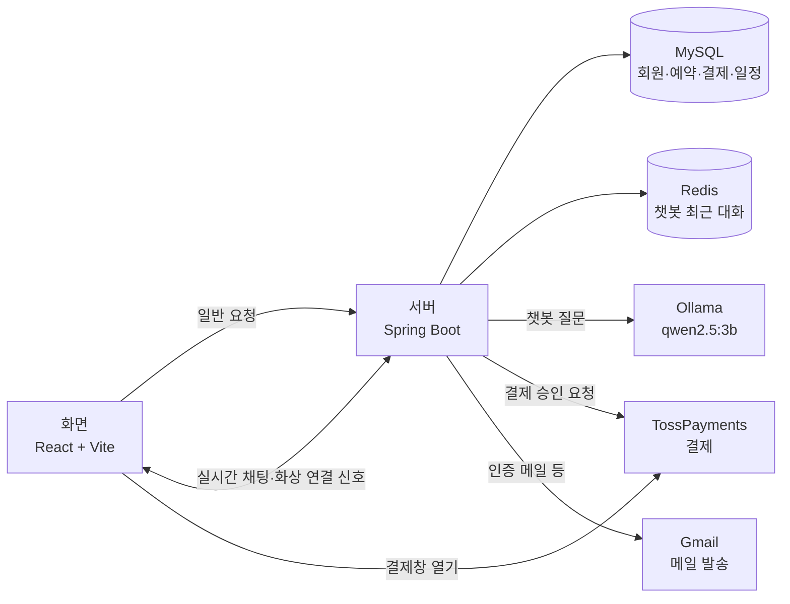
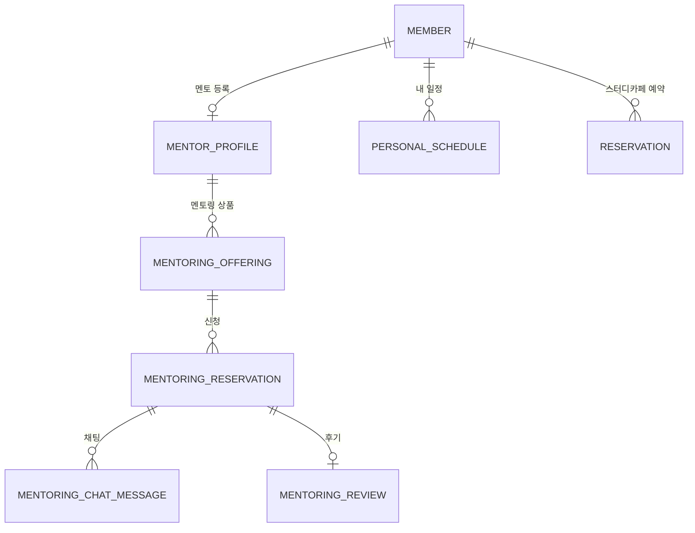

# 전체 구조

EASYS는 크게 **화면**(React)과 **서버**(Spring Boot)로 나뉘어 있습니다.
화면이 서버에 요청하면 서버가 DB에서 데이터를 꺼내 돌려줍니다. 서버는 필요할 때 AI, 결제, 메일 같은 외부 서비스를 부릅니다.

## 각 부분이 하는 일

| 부분 | 하는 일 |
|---|---|
| 화면 (React) | 사용자가 보는 페이지입니다. 버튼을 누르면 서버에 요청을 보냅니다. |
| 서버 (Spring Boot) | 로그인을 확인하고, 데이터를 저장·조회하고, 외부 서비스를 부릅니다. |
| MySQL | 오래 보관해야 하는 데이터(회원, 예약, 결제, 일정, 채팅)를 저장합니다. |
| Redis | 챗봇이 최근 대화를 잠깐 기억하는 데 씁니다. 정해진 시간이 지나면 지워집니다. |
| Ollama | AI 모델을 내 PC에서 실행합니다. 서버가 질문을 보내면 답변을 돌려줍니다. |
| TossPayments | 결제창을 띄우고, 서버의 승인 요청을 받아 결제를 확정합니다. |

## 요청 하나가 처리되는 과정

예를 들어 멘토가 "승인" 버튼을 누르면 다음 순서로 처리됩니다.

1. 화면이 서버에 승인 요청을 보냅니다. 로그인 정보는 세션 쿠키로 함께 갑니다.
2. **Spring Security**가 로그인한 사용자인지 확인합니다.
3. **Controller**가 요청을 받아 알맞은 **Service**에 넘깁니다.
4. **Service**가 실제 규칙을 처리합니다. 예를 들어 승인하는 사람이 이 예약의 멘토가 맞는지 확인하고 상태를 "승인"으로 바꿉니다.
5. **Repository**(JPA)가 DB에 변경 내용을 저장합니다.
6. 결과를 화면에 돌려주고, 필요하면 상대방에게 알림을 보냅니다.

서버 코드도 이 순서대로 폴더가 나뉘어 있습니다.

| 폴더 (`com.easys`) | 내용 | 예시 |
|---|---|---|
| `controller` | 요청을 받는 입구 | `MentoringReservationController`, `AiChatController` |
| `service` | 실제 처리 규칙 | `MentoringReservationService`, `PaymentService`, `AiChatService` |
| `repository` | DB 저장·조회 | `PersonalScheduleRepository` |
| `entity` | DB 테이블과 연결되는 클래스 | `MentoringReservation`, `Payment`, `PersonalSchedule` |
| `dto` | 화면과 주고받는 데이터 모양 | `AiChatResponseDto`, `ActionDto` |
| `config`, `security` | 로그인, 실시간 통신, 외부 서비스 설정 | `SecurityConfig`, `StompChatConfig`, `LlmProperties` |

## 실시간 통신

새로고침 없이 바로 주고받아야 하는 기능은 WebSocket을 씁니다.

- **멘토링 채팅** (`/ws-chat`, STOMP): 메시지를 저장한 뒤 그 예약의 채팅방을 구독한 사람에게 바로 보냅니다. 구독할 때 그 예약의 멘토나 신청자인지 서버가 확인합니다.
- **화상 스트리밍** (`/signal`): 화상 연결에 필요한 신호를 주고받습니다(팀원 담당). 미니 캘린더의 "일정이 바뀌었다" 알림도 이 연결로 같은 방 사람들에게 보냅니다.

## 주요 데이터의 관계

- 결제(`Payment`)는 "무엇에 대한 결제인지"를 종류(`MENTORING` / `STUDY`)와 대상 ID로 기록합니다. 그래서 멘토링과 스터디카페가 같은 결제 기능을 함께 씁니다.
- 일정(`PersonalSchedule`)에 방송방 ID가 있으면 그 방의 방송 일정으로 취급합니다.

## 설정과 비밀 정보

비밀번호와 키는 코드에 적지 않고 환경 변수나 Git에 올라가지 않는 `application-local.properties`로 넣습니다. 필요한 설정 목록은 [README의 실행 방법](../README.md#직접-실행해-보기)에 있습니다.
