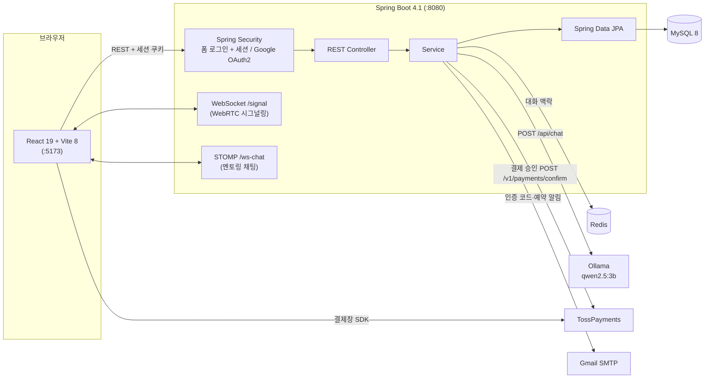
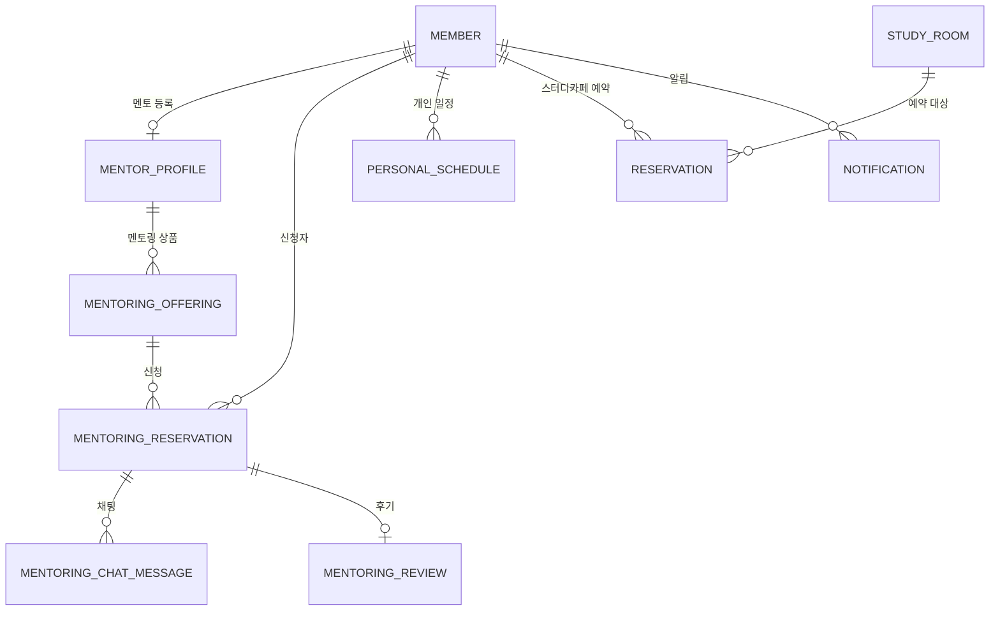

# 아키텍처

## 전체 구성

- 개발 환경에서는 Vite 프록시가 `/api`, `/streams`, `/signal`, `/ws-chat` 요청을 8080으로 넘깁니다. 일부 화면(방송방 등)은 `http://{호스트}:8080`을 직접 호출합니다.
- 인증은 세션 기반입니다. JWT는 사용하지 않습니다.

## 백엔드 패키지 (`com.easys`)
| 패키지 | 역할 | 예시 |
|---|---|---|
| `controller` | REST·STOMP 엔드포인트 | `AiChatController`, `MentoringReservationController`, `PaymentController` |
| `service` | 비즈니스 로직 | `AiChatService`, `MentoringReservationService`, `ReservationService`, `PaymentService` |
| `repository` | JPA 리포지토리 | `PersonalScheduleRepository`, `PaymentRepository` |
| `entity` | JPA 엔티티·상태 enum | `MentoringReservation`, `MentoringReservationStatus`, `Payment`, `PersonalSchedule` |
| `dto` | 요청·응답 DTO | `AiChatResponseDto`, `ActionDto`, `PaymentConfirmRequestDto` |
| `config` | 보안, WebSocket, STOMP, Redis, 외부 서비스 설정, 초기 데이터 | `SecurityConfig`, `StompChatConfig`, `LlmProperties`, `TossPaymentProperties` |
| `security` | 로그인 사용자, OAuth2 처리 | `CustomUserDetails`, `CustomOAuth2UserService` |

## 핵심 도메인 관계

- 결제(`Payment`)는 `productType`(`MENTORING` / `STUDY`)과 `targetId`로 멘토링 예약이나 스터디카페 예약을 가리킵니다.
- 개인 일정(`PersonalSchedule`)은 `streamingRoomId`가 있으면 해당 방송방의 원본 일정으로 취급됩니다.

## 외부 의존성과 설정
| 대상 | 설정 키 / 환경 변수 | 비고 |
|---|---|---|
| MySQL | `DB_URL`, `DB_USERNAME`, `DB_PASSWORD` | `ddl-auto=update` |
| Redis | `REDIS_HOST`, `REDIS_PORT` | 챗봇 세션 (`CHAT_SESSION_MAX_TURNS`, `CHAT_SESSION_TTL_MINUTES`) |
| Ollama | `LLM_BASE_URL`, `LLM_MODEL`, `LLM_TEMPERATURE` | 기본값 `http://localhost:11434`, `qwen2.5:3b`, `0.4` |
| TossPayments | `TOSS_CLIENT_KEY`, `TOSS_SECRET_KEY`, `VITE_TOSS_CLIENT_KEY` | 테스트 키만 사용 |
| Gmail SMTP | `GMAIL_USERNAME`, `GMAIL_APP_PASSWORD` | 인증 코드, 스터디카페 예약 알림 |
| Google OAuth2 | `GOOGLE_CLIENT_ID`, `GOOGLE_CLIENT_SECRET` | |
| Kakao | `VITE_KAKAO_JS_KEY` | 지도, 카카오톡 공유 |

비밀값은 환경 변수나 Git에서 제외된 `application-local.properties`로만 주입합니다 (`spring.config.import=optional:classpath:application-local.properties`).
