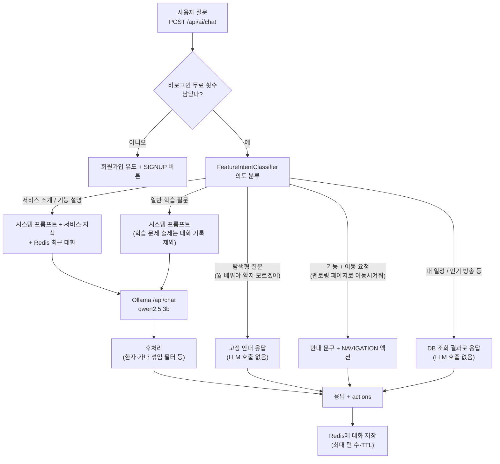
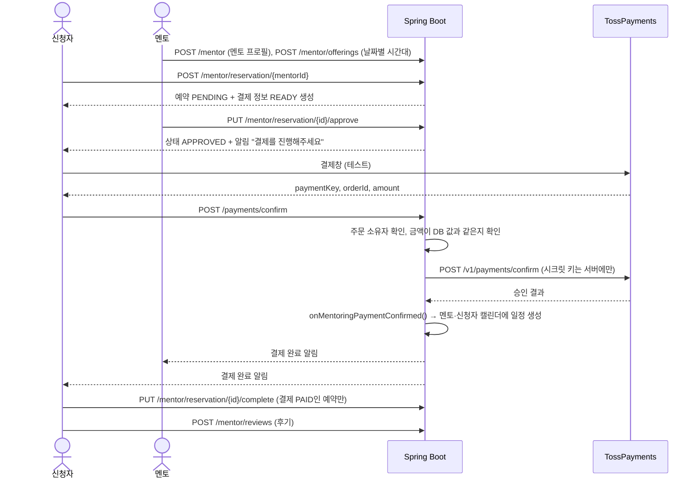
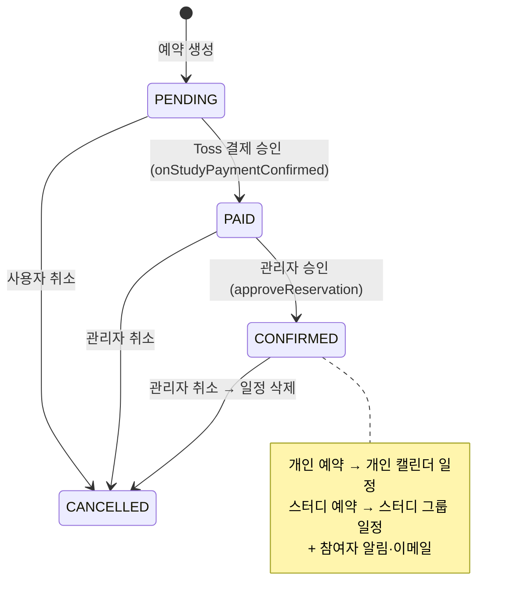
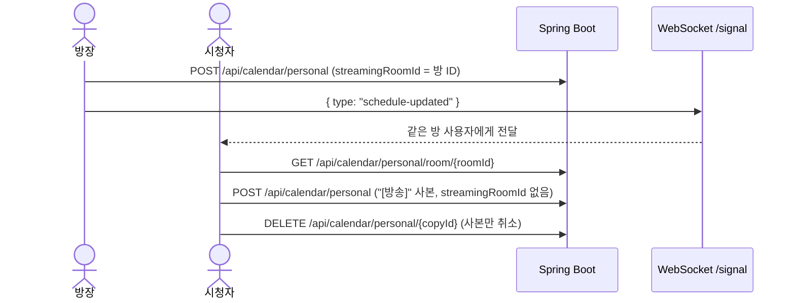
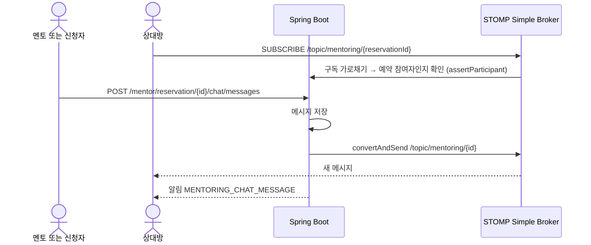

# 기능 흐름

코드에서 확인한 흐름만 그렸습니다. 각 흐름 끝의 **검증** 줄은 2026-10-12 실제 구동 결과입니다.

## 1. AI 챗봇

- 오타("멪토링")는 자모 단위 편집거리로 찾고, `confirmTypo=true`로 사용자에게 확인을 받습니다.
- 페이지 이동 버튼은 `ActionDto { type: NAVIGATION, target: MENTORING }` 형태입니다. 실제 경로는 프론트엔드가 `target`으로 정합니다.

**검증:** 서비스 소개, 이동 버튼 클릭 → `/mentor` 이동, 오타 확인, 탐색형 고정 안내, 내 일정 조회, 비로그인 3회 제한을 확인했습니다.

## 2. 멘토링: 신청 → 승인 → 결제 → 일정 저장

- **거절** (`PUT .../reject`): 결제를 취소하고, 이미 만든 일정이 있으면 지웁니다.
- 승인(`APPROVED`) 전에는 결제를 확정할 수 없습니다.
- 완료 처리는 결제가 끝난 예약에 대해 신청자가 합니다. 코드 주석상 시연을 위해 상담 날짜를 기다리지 않도록 한 설계입니다.

**검증:** 멘토 프로필·멘토링 등록 → 신청 → 승인 → 결제 대기(`READY`) 화면까지 확인했습니다. 금액 변조(1원)와 다른 사람 주문 승인 시도가 Toss 호출 전에 거부되는 것도 확인했습니다. Toss 실제 승인, 그 뒤 일정 생성, 완료·후기는 **미검증**입니다.

## 3. 스터디카페 예약 ↔ 캘린더

- 일정 생성은 `ReservationService.confirmReservationAndCreateCalendar()`에서 이루어집니다.
- 결제 승인 전에 결제 기한(`assertPaymentDeadlineNotPassed`)을 확인합니다.

**검증:** 스터디룸 목록 화면만 확인했습니다. 예약 → 결제 → 승인 → 일정 생성은 **미검증**입니다.

## 4. 스트리밍 미니 캘린더

**검증:** 방장 화면에서 방 일정 등록 후 해당 날짜 표시(REC)를 확인했습니다. 시청자 화면과 실시간 갱신은 **미검증**입니다.

## 5. 멘토링 실시간 채팅과 알림

- 멘토링 알림 종류: `MENTORING_RESERVATION_APPROVED`, `MENTORING_PAYMENT_COMPLETED`, `MENTORING_CHAT_MESSAGE`
- 알림 저장·조회 API와 헤더 알림 벨은 팀원이 만들었고, 멘토링 이벤트에서 알림을 보내는 부분을 본인이 구현했습니다.

**검증:** 코드 경로만 확인했습니다. 실제 송수신과 알림 표시는 **미검증**입니다.
