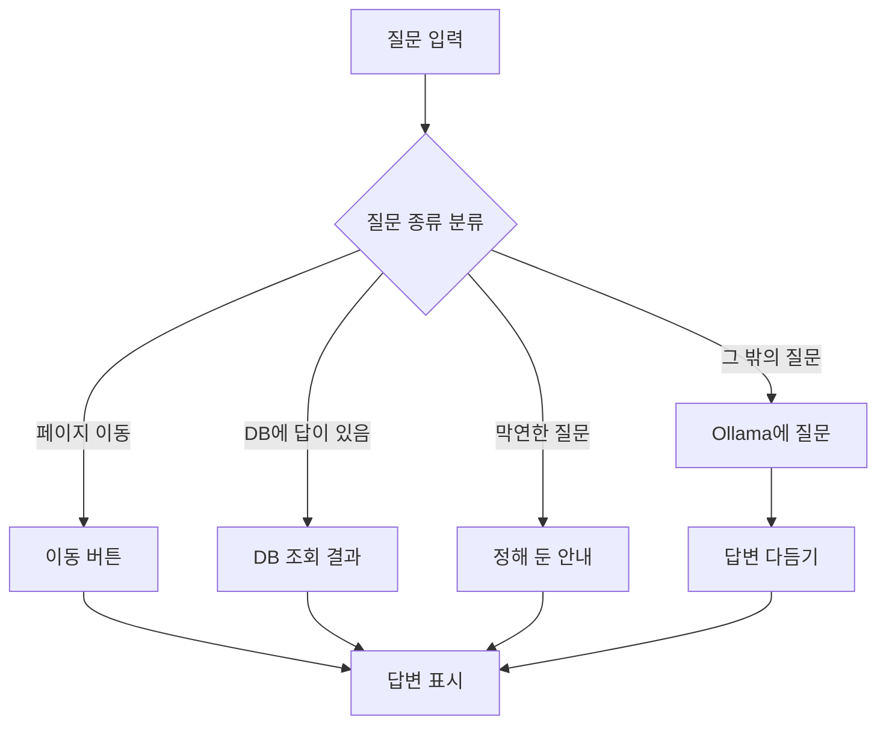
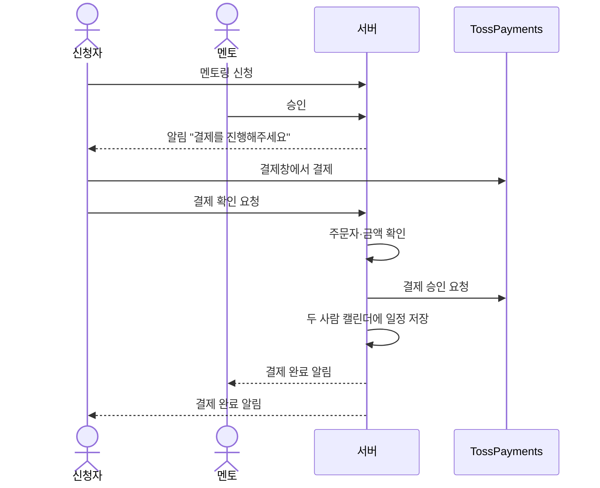

# 기능 흐름

사용자가 기능을 쓰는 순서대로 정리했습니다. 각 기능 끝에 실제로 실행해서 **확인한 부분**과 **아직 확인하지 못한 부분**을 적었습니다 (2026-10-12 기준).

---

## 1. AI 챗봇에게 묻기

1. 사용자가 챗봇 창에 질문을 입력합니다.
2. 로그인하지 않은 사용자는 3번까지만 물어볼 수 있습니다. 그 뒤로는 회원가입 버튼이 나옵니다.
3. 서버가 AI에게 보내기 전에 질문 종류를 먼저 나눕니다.
   - **페이지 이동 요청** ("멘토링 페이지로 가줘") → AI 없이 안내 문구와 이동 버튼을 보냅니다.
   - **정답이 DB에 있는 질문** ("내 일정 알려줘", "인기 방송 뭐야") → AI 없이 DB에서 찾아 답합니다.
   - **막연한 질문** ("뭘 배워야 할지 모르겠어") → 정해 둔 안내 문구로 되묻습니다.
   - **그 밖의 질문** → 서비스 설명과 최근 대화를 함께 붙여 AI(Ollama `qwen2.5:3b`)에게 보냅니다.
4. AI 답변에 한자나 일본어가 섞이면 걸러 냅니다.
5. 대화를 Redis에 저장해서 다음 질문 때 앞의 대화를 기억합니다.

- "멪토링"처럼 오타가 있으면 "혹시 '멘토링'을 말씀하신 건가요?"라고 확인합니다.
- 이동 버튼에는 주소 대신 목적지 이름(`MENTORING` 등)만 담습니다. 실제 주소는 화면 코드가 정합니다. AI가 없는 주소를 만들어 낼 수 없게 하려는 것입니다.

**확인:** 서비스 소개, 이동 버튼으로 `/mentor` 이동, 오타 확인, 막연한 질문 안내, 내 일정 조회, 비로그인 3회 제한

---

## 2. 멘토링 신청부터 일정 저장까지

1. **멘토 등록:** 멘토가 프로필을 만들고, 상담 가능한 날짜와 시간을 넣어 멘토링을 올립니다.
2. **신청:** 배우고 싶은 사람이 날짜를 골라 신청합니다. 이때 결제 정보가 "결제 대기" 상태로 함께 만들어집니다.
3. **승인 또는 거절:** 멘토가 승인하면 신청자에게 "결제를 진행해주세요" 알림이 갑니다. 거절하면 결제가 취소됩니다.
4. **결제:** 신청자가 결제창에서 결제합니다. 서버는 주문자와 금액이 맞는지 확인한 뒤 TossPayments에 승인을 요청합니다.
5. **일정 저장:** 결제가 끝나면 멘토와 신청자 **두 사람의 캘린더에 일정이 들어가고**, 두 사람에게 결제 완료 알림이 갑니다.
6. **완료와 후기:** 결제가 끝난 상담은 신청자가 완료 처리하고 후기를 남깁니다.

- 승인되기 전에는 결제할 수 없습니다.
- 상담 중에는 1:1 채팅을 합니다 (4번 항목).

**확인:** 멘토 등록 → 멘토링 등록 → 신청 → 승인 → 결제 대기. 금액을 바꾼 요청과 다른 사람의 결제 요청은 거절됨
**아직 확인하지 못함:** 실제 결제 승인, 결제 후 일정 저장, 완료와 후기

---

## 3. 스터디카페 예약과 캘린더

1. 스터디룸과 시간을 골라 예약합니다. (예약 대기)
2. 결제합니다. (결제 완료)
3. 관리자가 승인합니다. (예약 확정)
4. 확정되면 일정이 캘린더에 들어갑니다. 혼자 한 예약은 **내 캘린더**에, 스터디 모임으로 한 예약은 **모임 일정**에 들어가고 참여자에게 알림이 갑니다.
5. 관리자가 취소하면 일정도 지워집니다.

예약과 관리자 승인 기능은 팀원이 만들었고, 4~5번의 일정 연결은 제가 만들었습니다.

**확인:** 스터디룸 목록 화면
**아직 확인하지 못함:** 예약 → 결제 → 승인 → 일정 저장 전체 과정

---

## 4. 멘토링 1:1 채팅

1. 채팅 화면을 열면 그 예약의 채팅방을 구독합니다. 서버는 이 사람이 그 예약의 멘토나 신청자인지 확인하고, 아니면 막습니다.
2. 메시지를 보내면 서버가 먼저 DB에 저장합니다.
3. 서버가 같은 채팅방을 보고 있는 상대방에게 바로 전달합니다 (STOMP).
4. 상대방에게 새 메시지 알림도 보냅니다.

**아직 확인하지 못함:** 실제 메시지 주고받기와 알림 표시 (코드 흐름만 확인)

---

## 5. 방송방 미니 캘린더

1. 방장이 방송방의 미니 캘린더를 열고 날짜를 골라 방송 일정을 등록합니다.
2. 일정은 방장의 캘린더에 "이 방의 일정"으로 저장됩니다.
3. 같은 방에 있는 사람들에게 "일정이 바뀌었다"는 신호를 보내서, 모두의 미니 캘린더가 새로고침됩니다.
4. 시청자는 그 일정을 자기 캘린더에 복사해 넣거나, 넣은 것을 취소할 수 있습니다. 방장의 원래 일정에는 영향이 없습니다.

미니 캘린더의 처음 화면 틀과 방송방 페이지는 팀원이 만들었고, 일정 저장·조회와 화면 연결은 제가 만들었습니다.

**확인:** 방장 화면에서 이번 달로 열리고, 등록한 일정이 해당 날짜에 표시됨
**아직 확인하지 못함:** 시청자 화면, 여러 명에게 동시에 반영되는지
